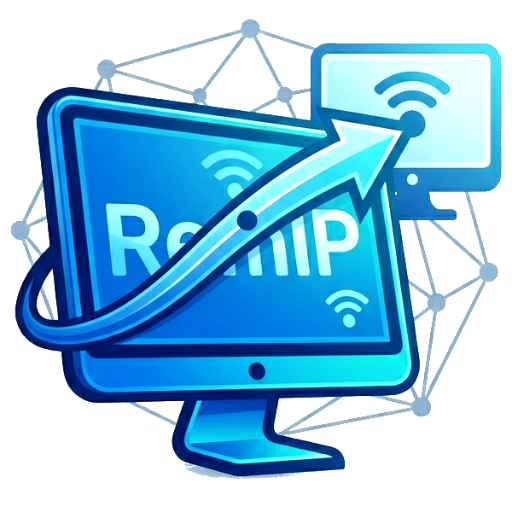

<h1 align="center">
  
  REMIP
</h1>

  <b>Удалённое управление компьютерами</b> 
  <i>Remote Environment Management & Interaction Platform</i>

  👤 <b>Автор:</b> dmistr &nbsp;&nbsp;|&nbsp;&nbsp; 📧 <b>Email:</b> dmistr9999@gmail.com &nbsp;&nbsp;|&nbsp;&nbsp; 🐙 <b>GitHub:</b> <a href="https://github.com/dmistr/Remip">dmistr/Remip</a>

---

## РУССКИЙ  &nbsp;&nbsp;|&nbsp;&nbsp; [ENGLISH](#english)

---

### 📋 ОГЛАВЛЕНИЕ

1. [Общее описание](#общее-описание)
2. [Быстрый старт](#быстрый-старт)
3. [Системные требования](#системные-требования)
4. [Главное меню](#главное-меню)
5. [Режим «Управление ПК»](#режим-управление-пк)
   - [IP и учётные данные](#ip-и-учётные-данные)
   - [Управление питанием](#управление-питанием)
   - [Агент Remip](#агент-remip)
   - [Скриншоты и стриминг](#скриншоты-и-стриминг)
   - [Терминал PowerShell](#терминал-powershell)
   - [Удалённое управление (Phantom Input)](#удалённое-управление-phantom-input)
   - [Контекстный помощник](#контекстный-помощник)
   - [Сообщения](#сообщения)
   - [Инструменты](#инструменты)
6. [Режим «Настройка ПК»](#режим-настройка-пк)
   - [Экспресс-настройка](#экспресс-настройка)
   - [Расширенная настройка](#расширенная-настройка)
   - [Локальный агент](#локальный-агент)
   - [Диагностика и сервис](#диагностика-и-сервис)
7. [Режим «Карта сети»](#режим-карта-сети)
   - [Сканирование](#сканирование)
   - [Таблица устройств](#таблица-устройств)
   - [Контекстное меню](#контекстное-меню)
   - [Групповые действия](#групповые-действия)
   - [Фоновый мониторинг](#фоновый-мониторинг)
8. [Окно настроек](#окно-настроек)
9. [Доступ через интернет (Pinggy/MQTT)](#доступ-через-интернет-pinggymqtt)
10. [Платформа Умного Агента](#платформа-умного-агента)
    - [Архитектура](#архитектура)
    - [Автономные подсистемы](#автономные-подсистемы)
    - [Watchdog и самовосстановление](#watchdog-и-самовосстановление)
11. [Phantom Input — протокол и реализация](#phantom-input--протокол-и-реализация)
12. [Автообновление](#автообновление)
13. [Обратная связь](#обратная-связь)
14. [Лицензия и контакты](#лицензия-и-контакты)
---

### ОБЩЕЕ ОПИСАНИЕ

**RemIP** — портативный инструмент для удалённого управления компьютерами в локальной сети и через интернет. Программа не требует установки — достаточно запустить EXE-файл от имени администратора. Весь функционал доступен «из коробки», без установки приложения, дополнительных библиотек, драйверов или виртуальных устройств.

**Три режима работы:**
- **Управление ПК** — удалённое управление компьютерами с настроенным WinRM или через интернет.
- **Настройка ПК** — подготовка текущего компьютера к приёму удалённых команд.
- **Карта сети** — сканирование локальной сети с групповыми действиями.

**Платформа Умного Агента** — легковесный PowerShell-сервер, доставляемый на удалённый ПК в один клик. Обеспечивает скриншоты, стриминг экрана (H.264/H.265), терминал, удалённое управление, заморозку процессов и многое другое. Включает в себя сторожевой механизм (Watchdog) для автоматического восстановления после сбоев.

---

### БЫСТРЫЙ СТАРТ

1.  **Запустите RemIP** от имени администратора.
2.  **Управляющий ПК:** перейдите в «Настройка ПК» → нажмите «Быстрая настройка».
3.  **Целевой ПК:** повторите шаг 2 на удалённом компьютере.
4.  **Сохраните учётные данные:** в «Управление ПК» введите IP, нажмите «ВВЕСТИ И СОХРАНИТЬ».
5.  **Установите агент:** нажмите на кнопку «АГЕНТ» → «Установить агент».
6.  **Готово!** Теперь доступны скриншоты, терминал, стриминг управление, и многое другое!

---

### СИСТЕМНЫЕ ТРЕБОВАНИЯ

| Компонент | Минимальные | Рекомендуемые |
|-----------|------------|---------------|
| **ОС** | Windows 10 | Windows 11 24H2 |
| **Серверные ОС** | Windows Server 2019 | Windows Server 2022 |
| **Права** | Администратор | Администратор |
| **PowerShell** | 5.1 | 5.1+ |
| **.NET Framework** | 4.8 | 4.8+ |
| **GPU (для стрима)** | DirectX 11 | NVIDIA GTX 10xx+ / AMD RX 5xx+ |
| **Сеть** | 3 Мбит/с | 50 Мбит/с |

---

### ГЛАВНОЕ МЕНЮ

При запуске программы открывается главное меню с тремя кнопками:

- **🖥️ Управление ПК** — удалённое управление компьютером по IP.
- **🛠️ Настройка ПК** — подготовка текущего ПК к приёму команд.
- **🌐 Карта сети** — сканирование локальной сети.

В верхней панели отображается ваш IP-адрес. Кнопки:
- **?** — окно «О программе».
- **⚙️** — настройки.
- **✕** — выход.
- **↩** — выход в меню.

Смена языка и темы доступна в настройках (шестерёнка) и применяется мгновенно.

---

### РЕЖИМ «УПРАВЛЕНИЕ ПК»

#### IP и учётные данные

**Поле ввода** — введите IPv4-адрес или Agent ID (`remip_...`) удалённого компьютера. Поле автоматически нормализует адрес.

**Кнопка статуса** — проверяет доступность ПК и запускает проверку агента:
- ▶ Серый — адрес введён, проверка не выполнялась.
- ⏳ Жёлтый — идёт проверка/подключение.
- ✓ Зелёный — ПК онлайн.
- ✗ Красный — ПК офлайн.
- ⏻ — агент подключён через интернет (нажмите для отключения).

**Фоновый мониторинг** — при вводе IP автоматически запускается проверка статуса. Пока вы работаете с этим IP, программа проверяет его доступность каждые 10 секунд.

**Выпадающий список** — все сохранённые адреса (IP и Agent ID) с именами. Иконка и цвет указывают на тип (`IP`/`ID`). Зелёная галочка ✓ означает, что учётные данные были проверены и успешно работают. ПКМ по адресу открывает контекстное меню для редактирования или удаления.

**ВВЕСТИ И СОХРАНИТЬ** — открывает диалог ввода логина и пароля. Программа проверяет учётные данные **до сохранения**:
- Проверяет доступность ПК (ping).
- Проверяет порт 5985 (WinRM).
- Выполняет тестовую команду.
- При успехе ставит ✓ в списке IP.
- При ошибке показывает причину и предлагает сохранить без проверки.
- Поддерживает **пустые пароли**.

**ОЧИСТИТЬ СПИСОК IP** — удаляет все сохранённые учётные данные, Clixml-файлы и очищает TrustedHosts.

#### Управление питанием

Все команды выполняются через WinRM на удалённом ПК или через агента (в интернет-режиме).

**ВЫКЛЮЧИТЬ ▼** — выпадающее меню:
- **Сейчас** — мгновенное выключение.
- **С таймером** — запрос времени в секундах, отправка команды выключения.
- **С текстом** — таймер + текстовое сообщение (до 460 символов), которое показывается пользователю перед выключением.
- **С голосом** — таймер + текст (до 512 символов), озвучивается, затем выключение.

**ПЕРЕЗАГРУЗИТЬ ▼** — выпадающее меню:
- **Сейчас** — мгновенная перезагрузка.
- **С таймером** — перезагрузка через N секунд.
- **С голосом** — озвучка + перезагрузка.

**ОТМЕНИТЬ** — отменяет запланированное выключение/перезагрузку.

**Режим «Анти-отмена»** (переключатель в верхней панели):
- **Выключен** — обычная команда shutdown, пользователь может отменить.
- **Включен** — после отправки команды программа ждёт (задержка настраивается) и проверяет статус ПК. Если не выключился — отправляет команду принудительно повторно.

#### Агент Remip

Центральный элемент управления. Кнопка «АГЕНТ» показывает текущее состояние цветом:

| Цвет | Состояние | ПКМ |
|------|-----------|-----|
| ⚫ Серый | Статус не проверен | Нажмите для проверки |
| 🔴 Красный | Агент не установлен / не запущен | Меню: Установить, Тест, Логи, Восстановить |
| 🟢 Зелёный | Агент установлен и работает | Меню: Удалить, Тест, Логи, Обновить, Перезагрузить, **Управление RemipWD** |

**Управление RemipWD:** Пункт меню «Запустить/Остановить RemipWD» позволяет управлять встроенным сторожевым процессом (watchdog), который автоматически перезапускает агента при зависании.

**Пункты зелёного меню:**
- **Удалить** — полная очистка: остановка процессов, удаление задачи планировщика, очистка папки агента, удаление правила брандмауэра.
- **Тест агента** — 13-шаговая диагностика: ping → порт 8080 → проверка файла агента → права доступа → брандмауэр → лог-файл → автозагрузка → версия → сессия и пр. При отсутствии токена предлагает добавить его через диалог.
- **Логи** — получает файл лога с удалённого ПК через агента, при недоступности — через WinRM. Отображает в диалоговом окне.
- **Обновить** — проверяет версию агента. Если устарела — переустанавливает. При выключенном WinRM включает его через самого агента.
- **Перезагрузить** — останавливает процессы агента и запускает заново без переустановки файлов.

**Пункты красного меню:**
- **Установить** — 11 шагов с индикацией прогресса: очистка, создание файлов, распаковка инструментов, запись токена, настройка брандмауэра, запуск и проверка.
- **Тест** — та же диагностика, что и в зелёном меню.
- **Логи** — получение логов через WinRM (агент не запущен).
- **Восстановить** — появляется, если файлы агента существуют, но он не запущен. Запускает агента заново.

#### Скриншоты и стриминг

**📸 СКРИНШОТ** — делает снимок экрана удалённого ПК через агента. Поддерживает PNG (без потерь) и JPEG (сжатие). Формат настраивается в настройках.

**Просмотрщик скриншотов (ScreenshotViewer):**
- **Зум:** колёсико мыши (25%-500% для статики, 25%-200% при LIVE).
- **Панорамирование:** зажать левую кнопку и тянуть.
- **Fit-to-Screen:** автоматически при открытии, двойной клик для сброса.
- **Сохранить:** выбор пути и формата (PNG/JPEG), по умолчанию на рабочий стол.
- **LIVE-режим:** переключатель запускает непрерывный стрим экрана.
- **🎮 Управление:** запускает полноэкранный режим с Phantom Input.

**Полноэкранный режим:**
- Анимация разворачивания из текущего окна на весь экран.
- Панель с FPS и трафиком в реальном времени.
- **Горячие клавиши:**
  - `Esc` — выход.
  - `F` или `0` — Fit-to-Screen.
  - `Пробел` — 100% зум.
  - `+/-` — зум.
  - `F12` — выход из Phantom Input.
  - `F1` — свернуть сеанс (стрим продолжается в фоне).
  - `Pause` — переключение Game Mode.
- **Сворачивание (F1):** диалог скрывается, главное окно сворачивается. Стрим и управление продолжают работать. Клик по иконке Remip на панели задач восстанавливает сеанс.

**Аппаратный стриминг:**
- **Захват:** DXGI Desktop Duplication, WGC (Windows Graphics Capture) или GDI.
- **Кодирование:** аппаратное через Media Foundation (NVENC/QuickSync/AMF).
- **Поддержка кодеков:**
    - **H.264:** Максимальная совместимость.
    - **H.265 (HEVC):** Меньше трафика при том же качестве. Требует поддержки GPU. **Новое:** в настройках можно выбрать `H.264`, `H.265` или `Auto` (попытка H.265 с автоматическим откатом на H.264 при неудаче).
- **Автоматический fallback:** при невозможности H.264/H.265 стрима автоматически переключается на GDI-захват.
- **Система «Светофор»** — адаптивное управление качеством и FPS в реальном времени (🟢 — повышение, 🟡 — стабилизация, 🔴 — снижение).

#### Терминал PowerShell

Интерактивный терминал с потоковым выводом. Запускается кнопкой «ТЕРМИНАЛ» в группе агента.

**Возможности:**
- **Автодополнение** — более 2000 команд PowerShell и их параметров.
- **Валидатор многострочного ввода** — автоматически преобразует многострочные скрипты в однострочный формат.
- **Умный декодер кодировок** — автоопределение кодировки вывода (cp1251/cp866/UTF-8).
- **История команд** — ↑↓ для навигации.
- **Анимация загрузки** — индикатор выполнения команды.
- **Масштабирование** — Ctrl+колесо.
- **Таймаут ожидания** — если команда зависла, через 8 секунд возвращается приглашение.

#### Удалённое управление (Phantom Input)

Полноценное управление мышью и клавиатурой удалённого ПК через собственный бинарный протокол. Не требует RDP, драйверов или виртуальных устройств.

**Запуск:** кнопка «🎮 Управление» в просмотрщике скриншотов → запускает стрим + Phantom Input одновременно.

**Два режима:**
- **🔵 Прямой (Direct):** полный захват мыши и клавиатуры. Курсор видим, все действия передаются на целевой ПК.
- **🟢 Фантом (Hidden):** скрытый режим. Вы можете двигать курсор — это не мешает пользователю на целевом ПК. Активные действия (клики, ввод) применяются моментально.

**Game Mode (Pause):**
- Рецентрирование курсора в центр экрана для бесконечного вращения.
- Относительные перемещения мыши.
- Настраиваемая чувствительность (0.1-2.0).

**Безопасность:**
- Автоотключение UAC на время сеанса.
- Автовосстановление UAC при выходе, обрыве связи или падении сервера.
- Сброс всех зажатых клавиш при отключении.

**Синхронизация буфера обмена:**
- При входе в управление: локальный буфер → целевой ПК.
- При сворачивании (F1): целевой ПК → локальный буфер.
- При разворачивании: локальный → целевой.

#### Контекстный помощник

Независимое окно мониторинга удалённого ПК. Открывается кнопкой «КОНТЕКСТ».

**Карточка «Сейчас»:**
- Активное окно (заголовок + процесс).
- Статус пользователя (активен/отошёл) с временем простоя.
- Автоопределение иконки приложения по имени процесса.

**Карточка «Ресурсы»:**
- **CPU:** прогресс-бар с цветовой индикацией.
- **RAM:** использовано/всего GB.
- **Диск C:** свободное место.
- **Топ-12 процессов** по потреблению RAM с контекстным меню (ПКМ):
  - ❄️ Заморозить / 🧊 Разморозить.
  - 🛑 Завершить процесс.
  - Подсветка строки при наведении.
  - Оранжевая подсветка замороженных процессов.

**Заморозка процессов:**
- Приостановка всех потоков процесса.
- Сворачивание видимых окон перед заморозкой.
- Автономный watchdog: перезаморозка при перезапуске процесса.
- Восстановление окон при разморозке.

**Лента событий (Timeline):**
- История действий на удалённом ПК.
- Автопрокрутка при нахождении внизу.
- Сохранение позиции скролла при обновлении.

**Экспорт отчёта:**
- **HTML с вкладками:** Обзор, Ресурсы, Статистика, Лента, Система.
- **SVG-графики** CPU и RAM за 24 часа.
- **Системная информация:** OS, CPU, RAM, диски, сетевые адаптеры.

**Дополнительно:**
- Закрепление окна поверх всех (📌).
- Настраиваемый интервал обновления (3-30 секунд).
- Ручное обновление (↻).

#### Сообщения

- **ТЕКСТОВОЕ** — отправка через `msg *` (до 240 символов). Поддерживает русский и английский. Работает даже без агента.
- **ГОЛОСОВОЕ** — озвучка через System.Speech.SpeechSynthesizer (до 512 символов). Требуется WinRM.

#### Инструменты

- **WinRM (ВКЛ/ВЫКЛ)** — управляет службой WinRM на вашем ПК. При включении синхронизирует TrustedHosts со всеми сохранёнными IP.
- **ДИАГНОСТИКА** — 11 этапов полной проверки подключения к удалённому ПК.
- **ОЧИСТИТЬ** — очищает окно вывода.

---

### РЕЖИМ «НАСТРОЙКА ПК»

Готовит текущий компьютер к приёму удалённых команд. Все изменения применяются локально.

#### Экспресс-настройка

**⚡ БЫСТРАЯ НАСТРОЙКА** — 7 шагов в фоновом потоке (не блокирует UI):
1. Удаление блокирующих правил для порта 5985.
2. Открытие порта 5985 для всех профилей.
3. Проверка порта.
4. Настройка службы WinRM.
5. Установка TrustedHosts.
6. Включение Remote UAC + пустого пароля.
7. Настройка SMB-клиента.

**💡 УМНАЯ НАСТРОЙКА** — диагностика системы → диалог выбора исправлений → применение только того, что нужно:
- Автоматическая настройка SMB-клиента при открытии порта 445.
- Автовозврат SMB в безопасное состояние при закрытии порта 445.
- Принудительная перезагрузка при необходимости.

#### Расширенная настройка

Цветные переключатели с автоматической проверкой статуса при входе:

**🌐 ПОРТЫ (445, 139, 5985):**
- 🟩 — правило включено и активно.
- 🟥 — правило отключено/отсутствует.
- Каждый порт управляется независимо.
- При открытии 445: автонастройка SMB-клиента + службы Server.
- При открытии 5985: автозапуск WinRM + настройка TrustedHosts.

**🛡️ ПРОФИЛИ (🏠 Частная, 🌍 Общественная, 🏢 Доменная):**
- Показывают текущий активный профиль.
- При переключении обновляют правила для всех открытых портов.

**🖥️ СЛУЖБЫ (Server, RemoteRegistry, WinRM):**
- Включение/отключение с автонастройкой автозапуска.

**🔐 РАЗРЕШЕНИЯ (Remote UAC, DCOM, RDP, Пустой пароль):**
- Независимое управление каждым параметром.

#### Локальный агент

Кнопка «АГЕНТ» в группе «Сервис» управляет агентом на локальном ПК. 8 шагов установки (сокращённая версия удалённой): очистка, создание файлов, распаковка, запись токена, настройка брандмауэра и запуск.

#### Диагностика и сервис

- **📊 ДИАГНОСТИКА** — многоэтапная проверка всех компонентов.
- **🗑️ СБРОС** — полный откат всех настроек с принудительной блокировкой портов и предложением перезагрузки.

---

### РЕЖИМ «КАРТА СЕТИ»

Сканирует локальную сеть и отображает все устройства.

#### Сканирование

- **⚡ БЫСТРОЕ** — 7 портов (135, 139, 445, 5985, 3389, 80, 443), ~30 секунд.
- **🔍 ПОЛНОЕ** — 17 портов + определение ОС по TTL и hostname, 1-5 минут.
- **🔄 ОБНОВИТЬ** — перепроверка ping/WinRM/creds/агента для найденных устройств.
- **⏹ СТОП** — остановка с принудительной очисткой через 3 секунды.

#### Таблица устройств

Два режима: компактный (▶) и расширенный (◀) с анимацией переключения.

**Столбцы расширенной таблицы:**
| Столбец | Значения |
|---------|----------|
| ☑ | Чекбокс выбора (только для 🟢) |
| Онлайн | ✅ / ❌ / ⏳ (обновляется фоном) |
| Статус | 🟢 Готов / 🟡 Нет данных / 🔵 Нужен WinRM / 🔴 Не поддерживается / ⚫ Офлайн |
| IP | IPv4-адрес |
| Имя | Hostname или тип ОС |
| WinRM | ✅ / ❌ |
| Данные | ✅ / ❌ |
| Агент | ✅ Проверен / ⚠️ Порт открыт / ❌ Не отвечает / — Не проверен |

**Сортировка:** клик по заголовку столбца.

#### Контекстное меню

ПКМ по строке таблицы:
- **Использовать IP** — переключение в «Управление ПК».
- **Сохранить учётные данные** — открыть диалог сохранения.
- **Диагностика** — запуск полной диагностики.
- **Проверить агента** — проверка порта 8080 + PSK-токен.
- **Контекстный помощник** — открыть окно мониторинга.
- **Wake-on-LAN** — отправка Magic Packet (если известен MAC).
- **Подробнее ▼** — IP, hostname, MAC, ОС, порты, WinRM, учётные данные.

#### Групповые действия

Панель появляется при выборе устройств чекбоксами (только 🟢).

| Кнопка | Описание |
|--------|----------|
| **🔴 ВЫКЛЮЧИТЬ** | Последовательное выключение с задержкой. |
| **💬 СООБЩЕНИЕ** | Один текст на все выбранные ПК. |
| **🎤 ГОЛОС** | Синхронизированная озвучка с компенсацией пинга. |
| **🤖 УСТАНОВИТЬ АГЕНТЫ** | Массовая параллельная установка (до 10 ПК одновременно). |

#### Фоновый мониторинг

Каждые 30 секунд проверяет онлайн-статус всех устройств. Обновляет иконки ✅/❌ и цветной статус. Работает только когда вкладка активна.

---

### ОКНО НАСТРОЕК

Вызывается кнопкой ⚙️ в верхней панели.

| Группа | Настройка | Значения | Описание |
|--------|-----------|----------|----------|
| **Выключение** | Задержка проверки | 15-99 сек | Время до проверки статуса ПК в режиме «Анти-отмена» |
| **Голос** | Режим отправки | 🔗 WinRM / 🤖 Агент | Способ отправки голоса при групповой рассылке |
| | Задержка синхронизации | 0.00-5.00 сек | Базовая пауза между ПК |
| | Компенсация пинга | ⚫ Выкл / 🟢 Авто / 🔵 Макс | Автоподстройка под сетевую задержку |
| **Общие** | Автодиагностика | Вкл/Выкл | Запуск проверки при входе в «Настройку ПК» |
| | Автообновление | Вкл/Выкл | Проверка GitHub при запуске |
| | Язык | Русский / English / Spanish | Мгновенное применение |
| | Тема | 🌙 Тёмная / ☀️ Светлая / Другие | Перезагрузка UI |
| **Скриншот** | Формат | PNG / JPEG | Без потерь или сжатие |
| **Управление** | Режим фантома | 🔵 Прямой / 🟢 Скрытый | Режим Phantom Input по умолчанию |
| | Чувствительность | 0.1-2.0 | Множитель мыши в Game Mode |
| **Стрим** | Адаптивный битрейт | 🔵 Вкл / ⚫ Выкл | Система «Светофор» |
| | Качество | 10-100 | Только при выключенном адаптивном режиме |
| | Макс. FPS | 10-60 | Целевая частота кадров |
| | **Кодек** | **Auto / H.264 / H.265** | **Выбор кодека для видеопотока** |
| **Логи** | Режим | ⚫ Выкл / 🟢 INFO / 🔵 DEBUG | Уровень детализации |
| | Хранение | Навсегда / 1 / 7 / 30 дней | Автоудаление старых логов |
| | 📂 ЛОГИ | Кнопка | Открыть папку с логами |
| **Агент** | Статистика | Вкл/Выкл | Сбор CPU/RAM/диска раз в минуту |

---

### ДОСТУП ЧЕРЕЗ ИНТЕРНЕТ (Pinggy/MQTT)

Программа поддерживает подключение к агенту из любой точки мира через сервис **Pinggy** — даже если целевой ПК находится за NAT, без «белого» IP-адреса и без настройки проброса портов на роутере. Агент сам создаёт защищённый туннель и публикует свой адрес, а клиент RemIP автоматически его находит.

#### 🔑 Как получить бесплатный токен Pinggy

Токен обязателен для интернет-доступа: **без него туннель не создаётся, и агент будет доступен только по локальной сети**. Получение токена занимает 1–2 минуты и не требует оплаты.

1. При установке агента включите переключатель **«Pinggy Token»** и нажмите кнопку **"Получить токен"** или предварительно откройте страницу регистрации: **https://dashboard.pinggy.io/register**.
2. Зарегистрируйтесь удобным способом:
   - через **Google** или **GitHub** (в один клик), либо
   - по **email**: укажите адрес и пароль, затем подтвердите регистрацию письмом из почты.
3. После входа откроется **Dashboard** (личный кабинет).
4. Найдите блок с вашим **Access Token** (длинная строка из букв и цифр). Обычно он отображается прямо на главной странице кабинета.
5. Нажмите **«Copy»** (или выделите токен и скопируйте вручную) — он понадобится на следующем шаге.
6. Вернитесь в RemIP и вставьте токен в соответствующее поле.
7. Нажмите **«Установить»** — агент сохранит токен и при запуске создаст туннель автоматически.

> 💡 **Бесплатного токена достаточно** для повседневного использования. Единственное ограничение бесплатного тарифа — туннель периодически пересоздаётся (примерно раз в 45–60 минут). RemIP делает это автоматически и незаметно для вас: клиент в этот момент переподключается за 1–3 секунды, а на удалённом ПК ничего не прерывается.

> При обновлении агента на новую версию существующий токен (если он был) подставится автоматически.

> 🔄 **Уже установлен агент без токена?** Не переустанавливайте вручную — нажмите ПКМ на кнопке «АГЕНТ» → «Обновить», а если версии совпадают, то предварительно удалите агент. В диалоге установки/обновления появится поле для токена. 

#### 🌐 Как это работает

- **Установка с токеном** — при установке агента вы указываете токен Pinggy. Без него интернет-доступ недоступен.
- **Поиск агента** — при подключении по Agent ID (`remip_...`) программа автоматически находит актуальный адрес туннеля через защищённый MQTT-брокер. Вам не нужно вручную вводить IP-адрес или порт.
- **Уникальный Agent ID** — каждый агент получает постоянный идентификатор, привязанный к «железу» ПК. Даже после переустановки Windows, сброса профиля или переезда на другой IP агент сохраняет свой ID, и вы продолжаете подключаться к нему как раньше.
- **Стабильность** — программа использует мультиплексирование каналов: управление, видео, аудио, фантомный ввод и терминал передаются через один туннель параллельно, не мешая друг другу.

#### 🔒 Безопасность и защита данных

При работе через интернет данные проходят через публичные сервисы (туннель Pinggy и MQTT-брокер), поэтому защита реализована на нескольких уровнях:

**1. Защищённый канал управления (Secure Channel)**
После установления соединения весь обмен командами шифруется по схеме **AES + HMAC-SHA256** (encrypt-then-MAC). Это означает:
- **Шифрование** — посторонний наблюдатель видит только поток случайных байтов, не понимая, что именно передаётся (скриншоты, команды, содержимое буфера обмена).
- **Защита от подмены** — для каждого сообщения вычисляется криптографический «отпечаток» (HMAC). Если злоумышленник попытается изменить хотя бы один байт в пакете, агент это обнаружит и отклонит сообщение. Без знания секретного ключа подделать HMAC невозможно.
- **Ключи выводятся из вашего токена** — сам токен по сети никогда не передаётся в открытом виде.

**2. Шифрование MQTT-публикаций (AES-256-CBC + HMAC)**
Когда агент публикует свой адрес туннеля через MQTT, содержимое пакета зашифровано. Брокер и любой, кто его слушает, видят только зашифрованный конверт (формата `RMP2:...`). Ключ выводится из уникального Agent ID агента, поэтому прочитать или подделать публикацию чужого агента невозможно.

**3. Защита от повторного воспроизведения (anti-replay)**
Каждый зашифрованный пакет содержит уникальный вектор инициализации (IV) и временную метку. Агент запоминает уже обработанные пакеты и отвергает любые попытки отправить их повторно. Это защищает от атаки «replay», когда злоумышленник записывает трафик и потом воспроизводит его.

**4. Защита от подбора токена (rate limit)**
На удалённом ПК работает лимит: не более **3 попыток подключения в минуту** с одного идентификатора и **10 в минуту** глобально. Перебор паролей и токенов становится практически невозможным.

**5. Сверка кода подтверждения при первом подключении** — см. следующий раздел.

> ⚠️ **Что НЕ защищено:** сам публичный сервис Pinggy технически видит объём передаваемого трафика (но не его содержимое — оно зашифровано). Если для вас критична полная приватность даже на уровне метаданных, используйте RemIP в локальной сети либо разверните собственный туннель.

#### 🛡️ Первая авторизация

При **самом первом** подключении к новому агенту между вашим ПК и удалённым ПК происходит «рукопожатие», которое гарантирует, что вы подключаетесь именно к своему агенту, а не к подставному серверу.

Как это выглядит:

1. **Ваш ПК** отправляет запрос на подключение к агенту.
2. **Агент** генерирует случайный **код подтверждения** (например, `A1B2-C3D4`) и показывает его на **своём экране** во всплывающем диалоговом окне: *«Запрос на подключение от администратора. Код: A1B2-C3D4. Разрешить постоянный доступ?»*
3. **В RemIP** на вашей стороне появляется точно такой же код в окне ожидания.
4. **Вы глазами сверяете** оба кода: тот, что показан на экране удалённого ПК (его видит пользователь за тем компьютером), и тот, что показывает RemIP у вас.
5. Если коды **совпадают** — значит, канал не перехвачен, и подключение безопасно. Пользователь на удалённом ПК нажимает **«Разрешить»** (или вы сами, если у вас есть физический доступ к тому ПК).
6. После подтверждения агент и ваш ПК **вырабатывают общий секрет** (ECDH — обмен ключами по эллиптическим кривым). На основе этого секрета вычисляется **постоянный токен**, уникальный для пары «ваш ПК ↔ этот агент».
7. Этот токен сохраняется на удалённом ПК и в RemIP. Все последующие подключения проходят автоматически, без диалогов и ввода кодов.

> 💡 **Что даёт эта процедура:** даже если злоумышленник знает ваш Agent ID и перехватил MQTT-публикацию с адресом туннеля, он не сможет подключиться — у него нет вашего токена. А вы, один раз подтвердив подключение, больше никогда не увидите это окно.

> 🔐 **Коды не передаются по сети в открытом виде** — они вычисляются на обеих сторонах независимо из общего секрета. Поэтому перехватить и подсмотреть код невозможно.

> ⚠️ **Если коды не совпадают** — ни в коем случае не подтверждайте подключение. Это может означать попытку MITM-атаки. Закройте диалог, проверьте сеть и повторите попытку.

**Сколько раз это происходит:** ровно один раз на каждую пару «ваш ПК ↔ новый агент». Если вы переустановите RemIP на новом ПК или почистите сохранённые учётные данные — процедура повторится. Удаление и повторная установка агента при этом **не сбрасывают** доверие, если вы используете тот же Agent ID и тот же ПК.

---

### ПЛАТФОРМА УМНОГО АГЕНТА

#### Архитектура

Агент — это легковесный сервер, который запускается на удалённом ПК и обеспечивает выполнение команд. При запуске он настраивает брандмауэр и автозагрузку, а затем запускает основной цикл обработки подключений. Он также компилирует встроенные компоненты для стриминга, удалённого управления и заморозки процессов.

#### Автономные подсистемы

Агент работает автономно и не требует постоянного подключения Remip:
- **Watchdog (агент):** проверяет состояние агента и перезапускает его при зависании.
- **Watchdog (заморозка):** каждые несколько секунд проверяет замороженные процессы и перезамораживает их при перезапуске.
- **Статистика:** раз в минуту собирает данные о нагрузке CPU/RAM/диска, хранит до 24 часов.

#### Watchdog и самовосстановление

**RemipWD (Watchdog)** — это отдельный процесс, который:
- Следит за heartbeat-файлом агента.
- Перезапускает агента при зависании или падении.
- Переживает перезагрузку ПК (запускается автоматически при входе в систему).
- Имеет механизм самовосстановления из резервной копии.

Управлять Watchdog можно через меню кнопки «АГЕНТ»: «Запустить/Остановить RemipWD».

---

### PHANTOM INPUT — ПРОТОКОЛ И РЕАЛИЗАЦИЯ

Собственный бинарный протокол для минимальных задержек.
- **Сервер:** C# класс, использующий Win32 API `SendInput` для эмуляции ввода.
- **Клиент:** TCP-сокет с `TCP_NODELAY` (отключение буферизации), троттлинг мыши, дельта-кодирование, атомарные клики.
- **Безопасность:** при запуске временно отключает UAC, при остановке или обрыве связи — восстанавливает.

---

### АВТООБНОВЛЕНИЕ

- Проверка GitHub при запуске (настраивается).
- Значок 🔔 в верхней панели при доступности новой версии.
- Скачивание в фоне с прогрессом.
- Кнопка «Перезапустить сейчас» для быстрого обновления.

---

### ОБРАТНАЯ СВЯЗЬ

В окне «О программе» (кнопка `?`) нажмите **📤 Обратная связь**. Опишите проблему, укажите email (опционально). Программа автоматически прикрепит системную информацию и последние строки лога.

---

### ЛИЦЕНЗИЯ И КОНТАКТЫ

**Proprietary Freeware** (проприетарная лицензия для личного использования).

- ✅ **Личное некоммерческое использование** — свободно.
- ❌ **Коммерческое использование** — только с письменного разрешения автора.
- ❌ **Продажа, перекомпиляция, декомпиляция, модификация** — запрещены.
- ⚠️ **Ответственность** — пользователь использует программу на свой страх и риск.

> **О PyQt6:** приложение использует PyQt6, распространяемый под GNU GPL v3.0. Проприетарная лицензия Remip применяется только к оригинальному коду автора.

Полный текст: [LICENSE.txt](LICENSE.txt).

По вопросам коммерческого лицензирования: **dmistr9999@gmail.com**

---

## ENGLISH &nbsp;&nbsp;|&nbsp;&nbsp; [РУССКИЙ](#русский)

<h1 align="center">
  
  REMIP
</h1>

  <b>Remote Management & Interaction Protocol</b> 
  <i>Universal tool for remote PC management via IP</i>

  👤 <b>Author:</b> dmistr &nbsp;&nbsp;|&nbsp;&nbsp; 📧 <b>Email:</b> dmistr9999@gmail.com &nbsp;&nbsp;|&nbsp;&nbsp; 🐙 <b>GitHub:</b> <a href="https://github.com/dmistr/Remip">dmistr/Remip</a>

---

### 📋 TABLE OF CONTENTS

1. [Overview](#overview)
2. [Quick Start](#quick-start)
3. [System Requirements](#system-requirements)
4. [Main Menu](#main-menu)
5. [PC Control Mode](#pc-control-mode)
   - [IP & Credentials](#ip--credentials)
   - [Power Management](#power-management)
   - [Remip Agent](#remip-agent)
   - [Screenshots & Streaming](#screenshots--streaming)
   - [PowerShell Terminal](#powershell-terminal)
   - [Remote Control (Phantom Input)](#remote-control-phantom-input)
   - [Context Assistant](#context-assistant)
   - [Messages](#messages)
   - [Tools](#tools)
6. [PC Setup Mode](#pc-setup-mode)
   - [Express Setup](#express-setup)
   - [Advanced Setup](#advanced-setup)
   - [Local Agent](#local-agent)
   - [Diagnostics & Service](#diagnostics--service)
7. [Network Map Mode](#network-map-mode)
   - [Scanning](#scanning)
   - [Device Table](#device-table)
   - [Context Menu](#context-menu)
   - [Group Actions](#group-actions)
   - [Background Monitor](#background-monitor)
8. [Settings Window](#settings-window)
9. [Internet Access (Pinggy/MQTT)](#internet-access-pinggymqtt)
10. [Smart Agent Platform](#smart-agent-platform)
    - [Architecture](#architecture)
    - [Autonomous Subsystems](#autonomous-subsystems)
    - [Watchdog & Self-Healing](#watchdog--self-healing)
11. [Phantom Input — Protocol & Implementation](#phantom-input--protocol--implementation)
12. [Auto-Update](#auto-update)
13. [Feedback](#feedback)
14. [License & Contacts](#license--contacts)

---

### OVERVIEW

**RemIP** is a portable tool for remote computer management in local networks and over the internet. No installation required — just run the EXE as Administrator. All functionality works out of the box without additional libraries, drivers, or virtual devices.

**Three operating modes:**
- **PC Control** — remote management of computers with WinRM or over the internet.
- **PC Setup** — prepare the current computer for receiving remote commands.
- **Network Map** — scan the local network with group actions.

**Smart Agent Platform** — a lightweight server delivered to a remote PC in one click. Provides screenshots, screen streaming (H.264/H.265), terminal, remote control, process freezing, and more. Includes a Watchdog for automatic recovery from failures.

---

### QUICK START

1.  **Run RemIP** as Administrator.
2.  **Controlling PC:** go to "PC Setup" → click "Fast Setup".
3.  **Target PC:** repeat step 2 on the remote computer.
4.  **Save credentials:** in "PC Control" enter the IP, click "SAVE CREDENTIALS".
5.  **Install the agent:** click the "AGENT" button → "Install".
6.  **Done!** Screenshots, terminal, streaming, and control are now available.

---

### SYSTEM REQUIREMENTS

| Component | Minimum | Recommended |
|-----------|---------|-------------|
| **OS** | Windows 10 | Windows 11 24H2 |
| **Server OS** | Windows Server 2019 | Windows Server 2022 |
| **Privileges** | Administrator | Administrator |
| **PowerShell** | 5.1 | 5.1+ |
| **.NET Framework** | 4.8 | 4.8+ |
| **GPU (for streaming)** | DirectX 11 | NVIDIA GTX 10xx+ / AMD RX 5xx+ |
| **Network** | 3 Mbps | 50 Mbps |

---

### MAIN MENU

When the program starts, the main menu opens with three buttons:

- **🖥️ PC Control** — remote PC management by IP.
- **🛠️ PC Setup** — prepare this PC to receive commands.
- **🌐 Network Map** — scan the local network.

The top panel shows your IP address. Buttons:
- **?** — About window.
- **⚙️** — Settings.
- **✕** — Exit.
- **↩** — Back to menu.

Language and theme can be changed in Settings (gear icon) and are applied instantly.

---

### PC CONTROL MODE

#### IP & Credentials

**Input Field** — enter the remote computer's IPv4 address or Agent ID (`remip_...`). The field automatically normalizes the input.

**Status Button** — checks PC availability and starts agent check:
- ▶ Gray — address entered, check not performed.
- ⏳ Yellow — checking/connecting.
- ✓ Green — PC online.
- ✗ Red — PC offline.
- ⏻ — agent connected via internet (click to disconnect).

**Background Monitoring** — when an IP is entered, status checking starts automatically. While you work with this IP, the program checks its availability every 10 seconds.

**Dropdown List** — all saved addresses (IP and Agent ID) with names. Icon and color indicate the type (`IP`/`ID`). A green checkmark ✓ means the credentials have been verified. Right-click to edit or delete.

**SAVE CREDENTIALS** — opens a login/password dialog. The program verifies credentials **before saving**:
- Checks PC availability (ping).
- Checks port 5985 (WinRM).
- Runs a test command.
- On success, marks ✓ in the IP list.
- On error, shows the reason and offers to save without verification.
- Supports **blank passwords**.

**CLEAR IP LIST** — removes all saved credentials, Clixml files, and clears TrustedHosts.

#### Power Management

All commands are executed via WinRM on the remote PC or via the agent (in internet mode).

**SHUTDOWN ▼** — dropdown menu:
- **Now** — instant shutdown.
- **Timer** — prompt for seconds, sends shutdown command.
- **With Text** — timer + text message (up to 460 chars) shown to the user before shutdown.
- **With Voice** — timer + text (up to 512 chars), spoken via SpeechSynthesizer, then shutdown.

**REBOOT ▼** — dropdown menu:
- **Now** — instant reboot.
- **Timer** — reboot after N seconds.
- **With Voice** — speech + reboot.

**CANCEL** — cancels a scheduled shutdown/reboot.

**Anti-Cancel Mode** (toggle in the top panel):
- **Off** — normal shutdown command, user can cancel.
- **On** — after sending the command, the program waits (configurable delay) and checks PC status. If not shut down, retries the command.

#### Remip Agent

The central control element. The "AGENT" button shows state by color:

| Color | State | Right-Click |
|-------|-------|-------------|
| ⚫ Gray | Status unchecked | Click to check |
| 🔴 Red | Agent not installed / not running | Menu: Install, Test, Logs, Recover |
| 🟢 Green | Agent installed and running | Menu: Remove, Test, Logs, Update, Restart, **Manage RemipWD** |

**Manage RemipWD:** The "Start/Stop RemipWD" menu item allows you to control the built-in watchdog, which automatically restarts the agent if it hangs.

**Green menu items:**
- **Remove** — full cleanup: stop processes, remove scheduled task, delete agent folder, remove firewall rule.
- **Test Agent** — 13-step diagnostics: ping → port 8080 → agent file check → permissions → firewall → log file → autostart → version → session and others. If a token is missing, it offers to add it via a dialog.
- **Logs** — fetches the log file from the remote PC via the agent or WinRM. Displays in a dialog window.
- **Update** — checks agent version. If outdated, reinstalls. If WinRM is disabled, enables it via the agent.
- **Restart** — stops agent processes and restarts without reinstalling files.

**Red menu items:**
- **Install** — 11 steps with progress indication: cleanup, file creation, tool extraction, token write, firewall setup, launch, and verification.
- **Test** — same diagnostics as the green menu.
- **Logs** — fetch logs via WinRM (agent not running).
- **Recover** — appears if agent files exist but the agent is not running. Restarts the agent.

#### Screenshots & Streaming

**📸 SCREENSHOT** — captures the remote PC screen via the agent. Supports PNG (lossless) and JPEG (compressed). Format is set in Settings.

**Screenshot Viewer:**
- **Zoom:** mouse wheel (25%-500% for static, 25%-200% during LIVE).
- **Pan:** hold left button and drag.
- **Fit-to-Screen:** automatic on open, double-click to reset.
- **Save:** choose path and format (PNG/JPEG), defaults to Desktop.
- **LIVE Mode:** toggle starts continuous screen streaming.
- **🎮 Control:** launches fullscreen mode with Phantom Input.

**Fullscreen Mode:**
- Expand animation from current window to full screen.
- FPS and traffic panel in real time.
- **Hotkeys:**
  - `Esc` — exit.
  - `F` or `0` — Fit-to-Screen.
  - `Space` — 100% zoom.
  - `+/-` — zoom.
  - `F12` — exit Phantom Input.
  - `F1` — minimize session (stream continues in background).
  - `Pause` — toggle Game Mode.
- **Minimize (F1):** dialog hides, main window minimizes. Stream and control continue working. Click the Remip icon on the taskbar to restore.

**Hardware Streaming:**
- **Capture:** DXGI Desktop Duplication, WGC (Windows Graphics Capture), or GDI.
- **Encoding:** hardware via Media Foundation (NVENC / QuickSync / AMF).
- **Codec Support:**
    - **H.264:** Maximum compatibility.
    - **H.265 (HEVC):** Less traffic for the same quality. Requires GPU support. **New:** you can choose `H.264`, `H.265`, or `Auto` (attempt H.265 with automatic fallback to H.264 on failure) in the settings.
- **Automatic Fallback:** if H.264/H.265 streaming is impossible, it automatically switches to GDI capture.
- **"Traffic Light" System** — adaptive quality and FPS control in real time (🟢 — increase, 🟡 — stabilize, 🔴 — decrease).

#### PowerShell Terminal

Interactive terminal with streaming output. Launched via the "TERMINAL" button in the agent group.

**Features:**
- **Autocomplete** — 2000+ PowerShell commands and their parameters.
- **Multiline Input Validator** — automatically converts multiline scripts to single-line format.
- **Smart Encoding Decoder** — auto-detection of output encoding (cp1251/cp866/UTF-8).
- **Command History** — ↑↓ for navigation.
- **Loading Animation** — command execution indicator.
- **Scaling** — Ctrl+wheel.
- **Loading Timeout** — if a command hangs, the prompt returns after 8 seconds.

#### Remote Control (Phantom Input)

Full mouse and keyboard control of the remote PC via a custom binary protocol. No RDP, drivers, or virtual devices required.

**Launch:** "🎮 Control" button in screenshot viewer → starts stream + Phantom Input simultaneously.

**Two modes:**
- **🔵 Direct:** full mouse and keyboard capture. Cursor is visible, all actions are transmitted to the target PC.
- **🟢 Phantom (Hidden):** hidden mode. You can move the cursor — it doesn't interfere with the user on the target PC. Active actions (clicks, typing) are applied instantly.

**Game Mode (Pause):**
- Cursor recentering to screen center for infinite rotation.
- Relative mouse movements.
- Adjustable sensitivity (0.1-2.0).

**Security:**
- Auto-disable UAC for the session duration.
- Auto-restore UAC on exit, connection loss, or server crash.
- Release all pressed keys on disconnect.

**Clipboard Sync:**
- On control entry: local clipboard → target PC.
- On minimize (F1): target PC → local clipboard.
- On restore: local → target.

#### Context Assistant

Independent remote PC monitoring window. Opens via the "CONTEXT" button.

**"Now" Card:**
- Active window (title + process).
- User status (active/away) with idle time.
- Auto-detection of app icon by process name.

**"Resources" Card:**
- **CPU:** progress bar with color indication.
- **RAM:** used/total GB.
- **Disk C:** free space.
- **Top 12 processes** by RAM usage with context menu (right-click):
  - ❄️ Freeze / 🧊 Unfreeze.
  - 🛑 Kill process.
  - Row highlight on hover.
  - Orange highlight for frozen processes.

**Process Freezing:**
- Suspend all threads of a process.
- Minimize visible windows before freezing.
- Autonomous watchdog: re-freeze on process restart.
- Window restoration on unfreeze.

**Timeline:**
- History of actions on the remote PC.
- Auto-scroll when at the bottom.
- Scroll position preservation on update.

**Report Export:**
- **HTML with tabs:** Overview, Resources, Statistics, Timeline, System.
- **SVG charts** for CPU and RAM over 24 hours.
- **System info:** OS, CPU, RAM, disks, network adapters.

**Additional:**
- Pin window on top (📌).
- Adjustable refresh interval (3-30 seconds).
- Manual refresh (↻).

#### Messages

- **TEXT** — send via `msg *` (up to 240 chars). Supports Russian and English. Works even without the agent.
- **VOICE** — text-to-speech via System.Speech.SpeechSynthesizer (up to 512 chars). Requires WinRM.

#### Tools

- **WinRM (ON/OFF)** — manages the WinRM service on your PC. When enabled, syncs TrustedHosts with all saved IPs.
- **DIAGNOSTICS** — 11-step full connection check to the remote PC.
- **CLEAR** — clears the output window.

---

### PC SETUP MODE

Prepares the current computer to receive remote commands. All changes are applied locally.

#### Express Setup

**⚡ FAST SETUP** — 7 steps in a background thread (non-blocking UI):
1. Remove blocking rules for port 5985.
2. Open port 5985 for all profiles.
3. Port check.
4. Configure WinRM service.
5. Set TrustedHosts.
6. Enable Remote UAC + blank password.
7. Configure SMB client.

**💡 SMART SETUP** — system diagnostic → fix selection dialog → apply only what's needed:
- Automatic SMB client configuration when opening port 445.
- Automatic SMB restoration to safe state when closing port 445.
- Forced reboot when necessary.

#### Advanced Setup

Color toggles with automatic status check on entry:

**🌐 PORTS (445, 139, 5985):**
- 🟩 — rule enabled and active.
- 🟥 — rule disabled/absent.
- Each port is managed independently.
- Opening 445: auto-configure SMB client + Server service.
- Opening 5985: auto-start WinRM + configure TrustedHosts.

**🛡️ PROFILES (🏠 Private, 🌍 Public, 🏢 Domain):**
- Show current active profile.
- On toggle, update rules for all open ports.

**🖥️ SERVICES (Server, RemoteRegistry, WinRM):**
- Enable/disable with auto-startup configuration.

**🔐 PERMISSIONS (Remote UAC, DCOM, RDP, Blank Password):**
- Independent control of each parameter.

#### Local Agent

The "AGENT" button in the "Service" group manages the agent on the local PC. 8 installation steps (shortened remote version): cleanup, file creation, extraction, token write, firewall setup, and launch.

#### Diagnostics & Service

- **📊 DIAGNOSTICS** — multi-stage check of all components.
- **🗑️ RESET** — full rollback of all settings with forced port blocking and reboot offer.

---

### NETWORK MAP MODE

Scans the local network and displays all devices.

#### Scanning

- **⚡ FAST** — 7 ports (135, 139, 445, 5985, 3389, 80, 443), ~30 seconds.
- **🔍 FULL** — 17 ports + OS detection by TTL and hostname, 1-5 minutes.
- **🔄 REFRESH** — re-check ping/WinRM/creds/agent for found devices.
- **⏹ STOP** — stop with forced cleanup after 3 seconds.

#### Device Table

Two modes: compact (▶) and expanded (◀) with switch animation.

**Expanded table columns:**
| Column | Values |
|--------|--------|
| ☑ | Selection checkbox (🟢 only) |
| Online | ✅ / ❌ / ⏳ (background updated) |
| Status | 🟢 Ready / 🟡 No creds / 🔵 Needs WinRM / 🔴 Not supported / ⚫ Offline |
| IP | IPv4 address |
| Name | Hostname or OS type |
| WinRM | ✅ / ❌ |
| Creds | ✅ / ❌ |
| Agent | ✅ Verified / ⚠️ Port open / ❌ Not responding / — Not checked |

**Sorting:** click column header.

#### Context Menu

Right-click on a table row:
- **Use IP** — switch to "PC Control".
- **Save Credentials** — open save dialog.
- **Diagnostics** — run full diagnostics.
- **Verify Agent** — check port 8080 + PSK token.
- **Context Assistant** — open monitoring window.
- **Wake-on-LAN** — send Magic Packet (if MAC is known).
- **Details ▼** — IP, hostname, MAC, OS, ports, WinRM, credentials.

#### Group Actions

Panel appears when devices are selected via checkboxes (🟢 only).

| Button | Description |
|--------|-------------|
| **🔴 SHUTDOWN** | Sequential shutdown with delay. |
| **💬 MESSAGE** | One text to all selected PCs. |
| **🎤 VOICE** | Synchronized speech with ping compensation. |
| **🤖 INSTALL AGENTS** | Mass parallel installation (up to 10 PCs simultaneously). |

#### Background Monitor

Every 30 seconds, checks the online status of all devices. Updates ✅/❌ icons and color status. Works only when the tab is active.

---

### SETTINGS WINDOW

Opened via the ⚙️ button in the top panel.

| Group | Setting | Values | Description |
|-------|---------|--------|-------------|
| **Shutdown** | Check delay | 15-99 sec | Wait time before checking PC status in Anti-Cancel mode |
| **Voice** | Send mode | 🔗 WinRM / 🤖 Agent | Voice delivery method for group messages |
| | Sync delay | 0.00-5.00 sec | Base pause between PCs |
| | Ping compensation | ⚫ Off / 🟢 Auto / 🔵 Max | Auto-adjust for network latency |
| **General** | Auto-diagnostic | On/Off | Run check on entering PC Setup mode |
| | Auto-update | On/Off | Check GitHub on startup |
| | Language | Russian / English / Spanish | Instant apply |
| | Theme | 🌙 Dark / ☀️ Light / Others | UI reload |
| **Screenshot** | Format | PNG / JPEG | Lossless or compressed |
| **Control** | Phantom mode | 🔵 Direct / 🟢 Hidden | Default Phantom Input mode |
| | Sensitivity | 0.1-2.0 | Mouse multiplier in Game Mode |
| **Stream** | Adaptive bitrate | 🔵 On / ⚫ Off | Traffic Light system |
| | Quality | 10-100 | Only when adaptive is off |
| | Max FPS | 10-60 | Target frame rate |
| | **Codec** | **Auto / H.264 / H.265** | **Codec selection for video stream** |
| **Logging** | Mode | ⚫ Off / 🟢 INFO / 🔵 DEBUG | Detail level |
| | Retention | Forever / 1 / 7 / 30 days | Auto-delete old logs |
| | 📂 LOGS | Button | Open logs folder |
| **Agent** | Statistics | On/Off | Collect CPU/RAM/disk every minute |

---

### INTERNET ACCESS (Pinggy/MQTT)

The program supports connecting to the agent from anywhere in the world via the **Pinggy** service — even if the target PC is behind NAT, without a public IP address, and without configuring port forwarding on the router. The agent creates a secure tunnel and publishes its address, and the RemIP client automatically discovers it.

#### 🔑 How to get a free Pinggy token

A token is required for internet access: **without it, no tunnel is created, and the agent will only be available on the local network**. Getting a token takes 1–2 minutes and is free.

1. When installing the agent, enable the **"Pinggy Token"** toggle and click the **"Get token"** button, or open the registration page in advance: **https://dashboard.pinggy.io/register**.
2. Sign up using any convenient method:
   - via **Google** or **GitHub** (one click), or
   - via **email**: enter your address and password, then confirm registration via the email you receive.
3. After signing in, the **Dashboard** (personal account) opens.
4. Locate the block with your **Access Token** (a long string of letters and digits). It's usually shown right on the main dashboard page.
5. Click **"Copy"** (or select the token and copy it manually) — you'll need it in the next step.
6. Return to RemIP and paste the token into the corresponding field.
7. Click **"Install"** — the agent saves the token and creates the tunnel automatically on startup.

> 💡 **A free token is sufficient** for everyday use. The only limitation of the free tier is that the tunnel is periodically recreated (roughly every 45–60 minutes). RemIP does this automatically and invisibly to you: the client reconnects in 1–3 seconds, and nothing is interrupted on the remote PC.

> When updating the agent to a new version, the existing token (if any) is pre-filled automatically.

> 🔄 **Already installed the agent without a token?** Don't reinstall manually — right-click the "AGENT" button → "Update"; if the versions match, uninstall the agent first. The install/update dialog will show a field for the token.

#### 🌐 How it works

- **Installation with a token** — you specify the Pinggy token when installing the agent. Without it, internet access is unavailable.
- **Agent discovery** — when connecting via Agent ID (`remip_...`), the program automatically discovers the current tunnel address through a secure MQTT broker. No manual entry of IP or port is required.
- **Permanent Agent ID** — each agent receives a persistent identifier tied to the PC's hardware. Even after reinstalling Windows, resetting the profile, or moving to a different IP, the agent keeps its ID, and you continue connecting to it as before.
- **Stability** — the program uses channel multiplexing: control, video, audio, phantom input, and terminal are transmitted over a single tunnel in parallel without interfering with each other.

#### 🔒 Security and data protection

When working over the internet, data passes through public services (the Pinggy tunnel and MQTT broker), so protection is implemented at multiple levels:

**1. Secure control channel**
After the connection is established, all command exchange is encrypted using **AES + HMAC-SHA256** (encrypt-then-MAC). This means:
- **Encryption** — an outside observer sees only a stream of random bytes and cannot tell what is transmitted (screenshots, commands, clipboard contents).
- **Tamper protection** — each message carries a cryptographic "fingerprint" (HMAC). If an attacker changes even one byte in a packet, the agent detects it and rejects the message. Forging the HMAC without the secret key is impossible.
- **Keys are derived from your token** — the token itself is never sent over the network in plaintext.

**2. MQTT publication encryption (AES-256-CBC + HMAC)**
When the agent publishes its tunnel address over MQTT, the payload is encrypted. The broker and anyone listening see only an encrypted envelope (format `RMP2:...`). The key is derived from the agent's unique Agent ID, so reading or forging another agent's publication is impossible.

**3. Replay protection (anti-replay)**
Each encrypted packet contains a unique initialization vector (IV) and a timestamp. The agent remembers already-processed packets and rejects any attempt to resend them. This protects against "replay" attacks, where an attacker records traffic and later replays it.

**4. Token brute-force protection (rate limit)**
The remote PC enforces a limit: no more than **3 connection attempts per minute** from a single identifier, and **10 per minute** globally. Password and token brute-forcing becomes practically impossible.

**5. Verification code matching on first connection** — see the next section.

> ⚠️ **What is NOT protected:** the Pinggy service itself technically sees the volume of transmitted traffic (but not its contents — it is encrypted). If you require full privacy even at the metadata level, use RemIP on a local network or deploy your own tunnel.

#### 🛡️ First-time authorization

On the **very first** connection to a new agent, a "handshake" occurs between your PC and the remote PC that guarantees you are connecting to your own agent and not to an impostor server.

Here's what it looks like:

1. **Your PC** sends a connection request to the agent.
2. **The agent** generates a random **verification code** (for example, `A1B2-C3D4`) and displays it on **its own screen** in a pop-up dialog: *"Connection request from administrator. Code: A1B2-C3D4. Grant permanent access?"*
3. **In RemIP** on your side, the exact same code appears in the waiting window.
4. **You visually compare** the two codes: the one shown on the remote PC's screen (seen by the user at that computer) and the one shown by RemIP on yours.
5. If the codes **match**, the channel is not intercepted, and the connection is secure. The user on the remote PC clicks **"Allow"** (or you do, if you have physical access to that PC).
6. After confirmation, the agent and your PC **derive a shared secret** (ECDH — Elliptic Curve Diffie-Hellman key exchange). Based on this secret, a **permanent token** is computed, unique to the pair "your PC ↔ this agent".
7. This token is saved on the remote PC and in RemIP. All subsequent connections happen automatically, without dialogs or code entry.

> 💡 **What this procedure gives you:** even if an attacker knows your Agent ID and has intercepted the MQTT publication with the tunnel address, they cannot connect — they don't have your token. And once you've confirmed the connection, you'll never see this dialog again.

> 🔐 **Codes are not transmitted over the network in plaintext** — they are computed independently on both sides from the shared secret. Intercepting or peeking at the code is impossible.

> ⚠️ **If the codes do not match** — never confirm the connection. This may indicate a MITM attack attempt. Close the dialog, check your network, and try again.

**How often this happens:** exactly once per pair "your PC ↔ new agent". If you reinstall RemIP on a new PC or clear saved credentials, the procedure repeats. Uninstalling and reinstalling the agent does **not** reset the trust if you use the same Agent ID and the same PC.

---

### SMART AGENT PLATFORM

#### Architecture

The agent is a lightweight server that runs on the remote PC and executes commands. On startup, it configures the firewall and autostart, then launches the main connection handling loop. It also compiles embedded components for streaming, remote control, and process freezing.

#### Autonomous Subsystems

The agent works autonomously and doesn't require a constant Remip connection:
- **Watchdog (agent):** checks the agent's state and restarts it if it hangs.
- **Watchdog (freeze):** every few seconds checks frozen processes and re-freezes them on restart.
- **Statistics:** every minute collects CPU/RAM/disk load data, stores up to 24 hours.

#### Watchdog & Self-Healing

**RemipWD (Watchdog)** is a separate process that:
- Monitors the agent's heartbeat file.
- Restarts the agent if it hangs or crashes.
- Survives PC reboots (launches automatically on user logon).
- Has a self-healing mechanism from a backup copy.

You can manage the Watchdog via the "AGENT" button menu: "Start/Stop RemipWD".

---

### PHANTOM INPUT — PROTOCOL & IMPLEMENTATION

Custom binary protocol for minimal latency.
- **Server:** C# class using Win32 API `SendInput` for input emulation.
- **Client:** TCP socket with `TCP_NODELAY` (no buffering), mouse throttling, delta encoding, atomic clicks.
- **Security:** on start, temporarily disables UAC; on stop or connection loss, restores it.

---

### AUTO-UPDATE

- Checks GitHub on startup (configurable).
- 🔔 icon appears in the top panel when a new version is available.
- Background download with progress.
- "Restart Now" button for quick update.

---

### FEEDBACK

In the "About" window (`?` button), click **📤 Feedback**. Describe the issue, optionally enter your email. The program automatically attaches system information and the last log lines.

---

### LICENSE & CONTACTS

**Proprietary Freeware** (proprietary license for personal use).

- ✅ **Personal non-commercial use** — free.
- ❌ **Commercial use** — only with written permission from the author.
- ❌ **Sale, recompilation, decompilation, modification** — prohibited.
- ⚠️ **Liability** — the user uses the program at their own risk.

> **About PyQt6:** this application uses PyQt6, distributed under GNU GPL v3.0. The Remip proprietary license applies only to the author's original code.

Full text: [LICENSE.txt](LICENSE.txt).

For commercial licensing inquiries: **dmistr9999@gmail.com**
